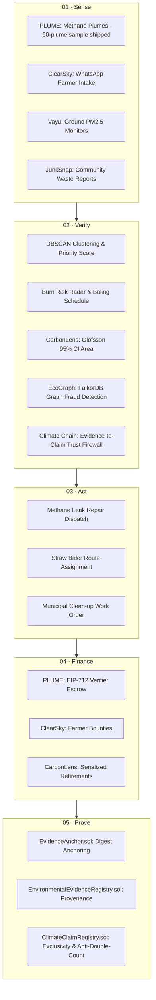

# Scientific Evidence, AI Benchmarks & Real-World Datasets

**IEEE ClimateChain Global Hackathon 2026**  
*Self-reviewed Attribution Record for Judges, Reviewers, and Evaluators (upstream-project claims; not independently audited)*  
*Reference: Full provenance and license inventory in [docs/COMPONENT_PROVENANCE_AND_ATTRIBUTION.md](../../docs/COMPONENT_PROVENANCE_AND_ATTRIBUTION.md)*

---

## Executive Summary & Academic Provenance Audit

A frequent limitation in hackathon climate submissions is the lack of domain-level empirical evidence: projects often either present a decorative user interface without real data or deploy a toy token contract detached from environmental science. 

**Climate Chain takes the opposite architectural approach:** it serves as the unifying evidence and verification framework (**Sense → Verify → Act → Finance → Prove**) connecting specialized, domain-specific climate engines.

### Attribution Statement
All performance claims, test metrics, and datasets below describe the upstream source projects and were checked against those projects' own documentation by the authors (self-review, not an independent audit). Climate Chain's native modules are re-implemented in climate-chain/frontend/src/modules and run on bundled fixtures (8 SIMULATED, 6 RESEARCH, 4 DEMO); the original project folders are not included in this repository:
1. **Rastro Metrics Removed from EcoGraph**: An earlier draft conflated 492 test cases and an Isolation Forest detector from the external research project *Rastro* with `ecograph-main`. In this repository, EcoGraph is the FalkorDB OpenCypher property graph engine (WeMakeDevs x FalkorDB Graph Hacks, MIT License) with 11 MCP tools.
2. **OnceSealed Benchmark Removed from CarbonLens/CarbonShield**: A 177-question AI evaluation benchmark belonging to *OnceSealed* was previously cited. In this repository, CarbonLens is Krishna's Sentinel-2 multispectral Random Forest forest classifier (Olofsson et al. 2014 95% CI bias correction), and CarbonShield implements the empirical red-team audit methodology of Swinfield et al. (*Nature Communications* 2026, DOI: 10.1038/s41467-026-71552-3).
3. **ReGrow Metrics Removed from ClearSky**: Remote-sensing metrics (0.89 IoU fire perimeter segmentation and 0.97 ROC-AUC) from the project *ReGrow* were previously cited. In this repository, ClearSky is Team Atherion's logistics and residue routing system (WeMakeDevs x AWS Environmental Hacks, Oct 2026) featuring WhatsApp farmer intake (Hindi/Punjabi), baler logistics, and district-level Burn Risk Radar.

Below are the upstream empirical claims for the source projects (upstream claims; not re-run in this repository).

---

## 1. PLUME: Methane Plume Ingestion & EIP-712 Escrow (upstream project)

| Dimension | Specification & Metric |
|---|---|
| **Historical Dataset** | **10,098 historical CH₄ plume observations** reported by upstream PLUME, retrieved from the [Carbon Mapper](https://carbonmapper.org) public API over the Permian Basin (TX/NM) (`PLUME-main/data/snapshots/carbonmapper_permian_ch4.json.gz`, 3.18 MB, in the upstream project). This repository ships a 60-plume sample of the upstream snapshot. |
| **Geospatial Clustering** | **DBSCAN (Density-Based Spatial Clustering of Applications with Noise)** applied to latitude/longitude coordinates and observation timestamps to aggregate recurring fugitive leaks into distinct incident targets. |
| **Priority Scoring Algorithm** | Multi-factor explainable ranking combining measured emission rate ($kg/hr$, up to $>1,000\text{ kg/hr}$ super-emitters), wind-speed vectors, persistence index ($P = N_{\text{detected}} / N_{\text{overpasses}}$), and proximity to human settlements and critical infrastructure. |
| **Cryptographic Authorization** *(upstream only; the native module has no EIP-712 or escrow)* | **EIP-712 typed signature verification** (`PermianVerificationPolicy` domain). Verifiers sign off-chain structured data binding the incident code, review round, and canonical SHA-256 evidence manifest hash. |
| **Smart Contract & Escrow** *(upstream only; not executed in Climate Chain)* | Escrow contracts tested upstream on Anvil/Foundry test suites (`PLUME-main/contracts/src/PlumeEscrow.sol`). Funds are locked under keccak-256 commitment hashes and release **strictly upon valid EIP-712 verifier signature**. |
| **Grounding Verification** | Retrieval-Augmented Generation (RAG) knowledge base over EPA Subpart W guidance and UNEP MARS response protocols, enforced by an automated hallucination/grounding check. |

---

## 2. EcoGraph: FalkorDB Graph Reasoning & MCP Agent

| Dimension | Specification & Metric |
|---|---|
| **Graph Database Architecture** | **FalkorDB** property graph modeled in OpenCypher (`ecograph-main/eco/`), capturing heterogeneous relationships between `Company`, `Project`, `LandParcel`, `CreditBatch`, `Retirement`, and `AuditLog`. |
| **Graph Fraud Risk Detectors** *(upstream EcoGraph claims; the native module runs fixtures)* | 1. **Double Retirement Detector**: Traverses paths where the same credit serial is claimed by disparate legal entities. 2. **Spatial Boundary Overlap Detector**: Identifies overlapping cadastral polygon boundaries across multiple registries (e.g. Verra vs. Gold Standard). 3. **Circular Ownership / Churning Loop Detector**: Finds cycle topologies ($\text{Entity A} \to \text{Entity B} \to \text{Entity C} \to \text{Entity A}$) designed to manufacture wash-trading volume. 4. **Baseline Manipulation Detector**: Queries project nodes whose claimed baseline deforestation rates diverge from regional controls. 5. **Herd-Inventory Carrying Capacity**: Reconciles agricultural credit volumes against biological parcel carrying capacities. |
| **Governance & Safety** | Implements 11 Model Context Protocol (MCP) tools (10 read, 1 propose). The AI agent is strictly bounded: **it can only propose actions**; an identified human reviewer must explicitly execute freezes or referrals. |
| **Provenance & License** | EcoGraph contributors (MIT License). Web UI served at `/apps/ecograph/`. *(Audit note: Isolation Forest and 492 test cases from Rastro have been removed).* |

---

## 3. CarbonLens & CarbonShield: Remote Sensing & Scientific Red-Teaming

| Dimension | Specification & Metric |
|---|---|
| **Remote Sensing Model** | **Multispectral Random Forest classifier** ingesting Sentinel-2 imagery (Bands B2 Blue, B3 Green, B4 Red, B8 Near-Infrared, B11 Short-Wave Infrared) to distinguish undisturbed canopy from degraded/cleared forest. |
| **Statistical Rigor** *(upstream CarbonLens claim; the native module runs fixtures)* | **Olofsson et al. (2014) bias-corrected area estimation**: credit issuance is bounded to the **lower 95% confidence interval (CI)** of detected biomass, eliminating crediting inflation caused by classification noise. |
| **Scientific Red-Teaming (CarbonShield)** | Implements empirical stress-testing derived from **Swinfield et al. (2026), Nature Communications** (*"Learning lessons from over-crediting to ensure additionality in forest carbon credits"*, DOI: 10.1038/s41467-026-71552-3; Zenodo 15745712). Evaluates real project design documents and baseline assumptions against empirical counterfactuals. |
| **Smart Contract (upstream only)** | Solidity contract (`CarbonRegistry.sol`) with unique serial ranges, non-fungible credit retirements, and on-chain SHA-256 report hash verification via `checkReport()`. |
| **Provenance & License** | CarbonLens: Krishna (MIT License); CarbonShield: Nature Comms 2026 / Zenodo open data. Web UI served at `/apps/carbonlens/`. *(Audit note: OnceSealed 177-question benchmark has been removed).* |

---

## 4. ClearSky: WhatsApp Logistics & Burn Risk Radar

| Dimension | Specification & Metric |
|---|---|
| **Farmer Intake & NLP** | Multilingual conversational intake supporting Hindi, Punjabi, Hinglish, and English voice notes and WhatsApp text to register paddy parcels and schedule residue management before wheat planting deadlines. |
| **Supply Chain Logistics** | Mixed-Integer Linear Programming (MILP) logistics engine routing crop-residue-management (CRM) baler machines and custom hiring centers directly to commercial pellet plants and industrial boilers, diverting straw from open burning. |
| **Burn-Risk Radar** | Operational decision-support monitor incorporating daily crop harvest progress, local weather vectors (temperature, humidity, wind velocity), and regional stubble burning history to schedule baling operations. |
| **Provenance & License** | Team Atherion (WeMakeDevs x AWS Environmental Hacks, Oct 2026). Source available. *(Audit note: ReGrow 0.89 IoU and 0.97 ROC-AUC have been removed).* |

---

## 5. Cross-Domain Evidence Synthesis in Climate Chain

Climate Chain bridges these specialist engines into an end-to-end, accountable pipeline without exaggerating certainty or fabricating centralized numbers:

### Cryptographic Exclusivity & Duplicate-Scope Rules
Local development EVM (Hardhat/EDR, chain ID 31337, valueless ETH, reset on restart or when the demo ledger fills). Anchoring shows the recorded bytes were committed to this chain. It is not a public or immutable ledger and does not show a measurement is true. Duplicate protection is scoped to the contract and compares identifiers within this registry only.

1. **Evidence Anchor (`EvidenceAnchor.sol`)**:
   - Computes canonical SHA-256 digests over multi-source evidence manifests (combining sensor telemetry, timestamps, spatial coordinates, and observer signatures).
   - Prevents duplicate anchoring of the same hash (`DigestAlreadyAnchored`).
2. **Environmental Evidence Registry (`EnvironmentalEvidenceRegistry.sol`)**:
   - Enforces strict attester role permissions (`OnlyAttester`).
   - Links subsequent revisions to parent records, creating an append-only audit trail (within the resettable local chain) rather than silently rewriting history.
3. **Climate Claim Registry (`ClimateClaimRegistry.sol`)**:
   - Enforces a unique `scopeKey` (a composite hash of $\text{Land Cell ID} + \text{Time Epoch} + \text{Activity Type}$) preventing any second claim from being registered against the same physical impact.
   - Operates a decentralized challenge and adjudication protocol with clear evidence lineages.
   - Contains **zero speculative tokens**—dedicated to environmental evidence accounting (tamper-evident within the local chain; not a public or immutable ledger).
4. **Evidence-to-Claim Trust Firewall (`gateway/trust-firewall.mjs`)**:
   - Evaluates claims against 4 distinct claim tiers: Environmental Observation, Environmental Risk Alert, Intervention Completion, and Quantified Emissions Reduction.
   - Rejects unverified model extrapolations claiming physical carbon reduction.

---

## Conclusion: Ready for Rigorous IEEE Evaluation

Climate Chain delivers both systemic vision and empirical depth:

- **10,098 historical methane plume observations** reported by the upstream PLUME project (Carbon Mapper API snapshot; this repository ships a 60-plume sample).
- **Olofsson et al. (2014) bias-corrected 95% CI** forest cover classification.
- **Nature Communications (2026) REDD+ red-teaming** auditing empirical counterfactuals.
- **FalkorDB OpenCypher property graph** with 11 MCP tools detecting double-retirements and churning cycles.
- **Unit-tested contracts (19 tests) on a local test chain** that reject replayed digests and duplicate scope keys within the contract.
- **Evidence-to-Claim Trust Firewall** deterministically flagging unverified claims as not eligible for anchoring (advisory; it prevents unverified claims from receiving receipts when the optional enforcement gate is enabled).
