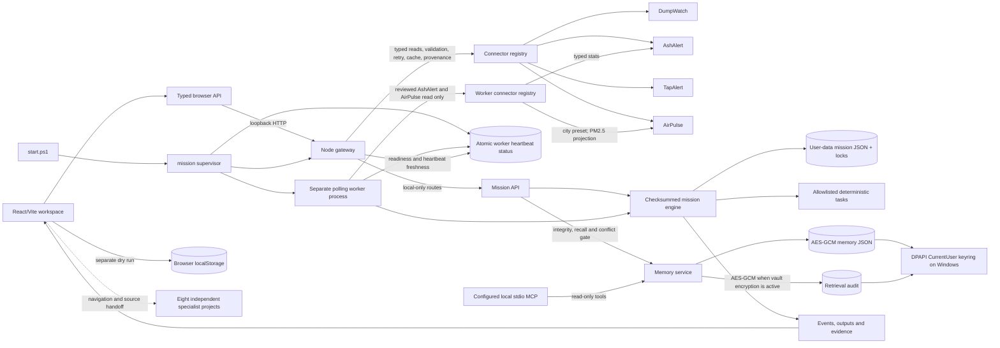

# Project Genesis — forensic architecture reconstruction

> **Status note (2026-10-22):** This document records the pre-implementation forensic snapshot. Its implementation-state statements are historical. See [GENESIS_PROGRESS.md](GENESIS_PROGRESS.md) and [GENESIS_FINAL_REPORT.md](GENESIS_FINAL_REPORT.md) for the current verified architecture and limits. The source boundary analysis and 13-capability inventory below remain useful.

## Current central data-flow graph

The launcher starts a process supervisor that manages the loopback gateway and a separate polling worker; the supervisor restarts unexpected worker exits with capped exponential backoff and terminates both child processes on Ctrl+C. The gateway starts on `127.0.0.1`. Read connectors can fall back only to explicitly simulated overview values, enforce a 2 MiB default response-body limit for reads and health checks, and keep a 128-entry/16 MiB serialized-payload cache. Mission handlers have no arbitrary shell, filesystem, database, or network tools. The worker reads the same locked mission store and only claims tasks with a recent memory-readiness trace. Its connector task can make only a AshAlert aggregate-statistics read or a AirPulse read at one of three shared configured city centers. It applies source-specific projections and stores provenance. The AirPulse projection omits exact query coordinates, place/station identifiers and free-text rationale, and caps retained PM2.5 samples at 24. MCP is read-only. The separate browser-local five-stage dry run does not share the backend mission store.

**Audit date:** 2026-10-22  
**Workspace:** repository set rooted at this directory; central product source is climate-chain/.  
**Method:** source and package-manifest inspection. This is not a claim that remote services were reachable or that every project builds in the present environment.

## Executive findings

This workspace is a federation of 13 independently developed capability sets, not a single application with 13 in-process modules. The central React/Vite app currently unifies navigation, four read-oriented signal views, a local memory interface, and a browser-local mission dry run. Its Node gateway fans out to four project APIs and normalizes a subset of those products’ schemas. The remaining eight specialists keep their own UI, data ownership, authentication, approval rules, and runtime.

The highest-value dependency chain is: **bound and authorize the gateway → define typed connector and evidence contracts → persist missions and state transitions on the server → execute an allowlisted local task with leases/idempotency → attach validation, source and memory evidence → render/replay that trace**. Agent coordination and broader specialist integration depend on those durable contracts. Rewriting the projects into one application would increase risk and discard useful source-owned policies.

Reported as project facts, not proven by this source audit:

- The previous mission reports the central frontend build, 27 gateway tests, and browser width checks as passing. I did not rerun them in this read-only workstream.
- The previous mission reports that the regular local vault has no user records. No vault contents were read by this audit.
- Runtime reachability, installed cloud credentials, deployment state, and current production status were not verified here.

## Current dependency graph

~~~mermaid
flowchart LR
  subgraph CC[Climate Chain central workspace]
    UI[React 19 + Vite UI]
    API[typed fetch helpers]
    GW[Node HTTP gateway]
    NORM[4 normalizers + overview fan-out]
    CAS[Cascade read-only evidence check]
    MEM[Memory HTTP API]
    MCP[Read-only stdio MCP]
    VAULT[External local JSON vault]
    MISSION[Browser localStorage mission records]
    GLOBE[Three.js globe]
    UI --> API --> GW
    UI --> MISSION
    UI --> GLOBE
    GW --> NORM
    GW --> CAS
    GW --> MEM --> VAULT
    MCP --> VAULT
  end

  subgraph Connected[Four central API sources]
    JS[DumpWatch Fastify API]
    CS[AshAlert AWS API]
    TS[TapAlert Lambda API]
    VY[AirPulse API]
  end
  NORM --> JS
  NORM --> CS
  NORM --> TS
  NORM --> VY
  CAS --> JS
  CAS --> VY

  subgraph Specialist[Eight source-owned handoff systems]
    AQ[BlueTrail static PWA + local demo API]
    CL[CarbonScope Python pipeline + Hardhat]
    SH[SinkGuard FastAPI artifacts]
    CT[UniqueCredit Python pipeline + Vite + in-memory EVM tests]
    EG[ImpactGraph Python graph API + MCP]
    GR[Grounded pnpm TypeScript simulation + SQLite world ledger]
    PL[MethaneMend FastAPI + PostgreSQL/PostGIS + Next.js snapshot/app]
    R3[SupplyTrail Next.js + PostgreSQL/Prisma + web3 flows]
  end
  UI -. navigation/handoff only .-> AQ
  UI -. navigation/handoff only .-> CL
  UI -. navigation/handoff only .-> SH
  UI -. navigation/handoff only .-> CT
  UI -. navigation/handoff only .-> EG
  UI -. navigation/handoff only .-> GR
  UI -. navigation/handoff only .-> PL
  UI -. navigation/handoff only .-> R3

  JS --> JSAWS[AWS Cognito, DynamoDB, S3, SQS]
  CS --> CSDATA[generated phase artifacts + optional chain reads]
  TS --> TSAWS[AWS DynamoDB, Step Functions, Cedar]
  VY --> VYAWS[AWS Lambda, DynamoDB, S3, Cognito]
  EG --> EGDB[FalkorDB / FalkorDB Lite]
  GR --> GRDATA[climate sources + local durable world store]
  PL --> PLDATA[Carbon Mapper snapshots/live provider + DB + local Anvil]
  R3 --> R3DATA[PostgreSQL + external chain/storage providers]
~~~

Graph arrows show source-level dependencies and current handoffs; a dashed line does not mean common identity, common storage, or remote execution.

## Boundaries and evidence

### Central application

- Frontend package is React 19 and Vite 8 with TypeScript; the scripts provide build/type-check but no lint or unit-test script (climate-chain/frontend/package.json:5-24). Main view selection is internal state in App rather than a route-backed application router (climate-chain/frontend/src/App.tsx:19-33, 110-113).
- Typed browser API helpers call the central gateway (climate-chain/frontend/src/api.ts:108-123, 193-209). The product feeds, status, and cascade endpoints are served by one dependency-free Node HTTP server (climate-chain/gateway/package.json:2-12; climate-chain/gateway/gateway.mjs:314-357).
- The overview fans out to DumpWatch, AshAlert, TapAlert, and AirPulse, and calls labelled local mocks when a fetch fails (climate-chain/gateway/gateway.mjs:77-85, 146-177). services.mjs sets a seven-second request timeout and contains those four source URLs and normalizers (climate-chain/gateway/services.mjs:6-42, 47-50, 69-165). A timeout is not a circuit breaker, retry policy, schema-version negotiation, or cache.
- Cascade is a distinct read-only candidate assessment using DumpWatch and AirPulse; a demo path is explicit and marked simulated (climate-chain/gateway/gateway.mjs:180-280 and climate-chain/gateway/cascade.mjs:1-140). It must remain a proximity/recency review lead, not a causal conclusion.
- The generic upstream proxy forwards the request method, body, and supplied Authorization header (climate-chain/gateway/gateway.mjs:101-143). This is broader than a read-only connector contract. The gateway also sets wildcard CORS on ordinary JSON and proxy responses (gateway.mjs:61-69, 130-139, 315-330) and calls server.listen(PORT) without an explicit host (gateway.mjs:357). Before network exposure, bind explicitly and set a narrow origin and caller authorization policy. No central account/role middleware is visible in the request dispatcher.
- TapAlert is specially reduced to an aggregate response and strips household identifiers, message content, and coordinates in this gateway path (gateway.mjs:119-128); do not widen that contract without a privacy review.
- Mission data is versioned in browser localStorage; the UI explicitly calls runs simulations and says source APIs were not called (frontend/src/modules/MissionRuntime.tsx:22, 44-59, 175-187, 244-260). Reload durability therefore applies only to that browser profile, not to a backend or another client.
- Memory is stored outside the project in a local JSON file, with schema v1→v2 conversion, SHA-256 record digests, an atomic replacement path, lock files, and retained backups (gateway/agent-memory.mjs:21-61, 317, 415-470, 481-524, 534-575). Those hashes detect accidental/simple tampering but are not keyed authentication. No encryption or SQLite dependency exists in this module. The memory MCP bridge is stdio and declares read-only tools; its instructions mark saved memory untrusted and subordinate to higher authority (gateway/memory-mcp.mjs:1-2, 28-82, 142). Memory HTTP endpoints have local-client/origin checks (agent-memory.mjs:1126-1203), but the general gateway remains a separate boundary.
- The central gateway test suite exists under climate-chain/gateway/tests/; package script is npm test (gateway/package.json:8-12). This audit did not execute it.

### All capability sets

The table distinguishes source implementation from current central integration. Evidence paths in table rows are relative to that capability's project folder. “Runtime unverified” means source code and configuration exist; this audit did not test cloud credentials, upstream reachability, or a hosted deployment.

| Capability | Source stack and ownership | API, persistence, identity, and simulated behavior | Central integration and audit evidence |
|---|---|---|---|
| **1. Climate Chain** | React/TypeScript/Vite frontend; Node native HTTP gateway | Four schema normalizers and explicit fallback data; independent local JSON memory vault; browser-local mission records; no shared identity or durable mission service. Ordinary gateway responses include wildcard CORS; generic proxy forwards request verbs. | Native dashboard and signal views; gateway adapter for four sources, no specialist action execution. climate-chain/frontend/package.json:5-24; gateway/gateway.mjs:77-85, 101-143, 314-357; frontend/src/modules/MissionRuntime.tsx:22, 175-187. |
| **2. DumpWatch** | Vite/React app; Fastify/TypeScript backend; backend declares Node >=24; AWS infrastructure | Cognito JWT verifier, DynamoDB-backed domain repositories, S3 media, SQS worker paths. Public sites read route is separate from signed-in vote/cleanup/withdraw routes. Writes and verification belong to the project. Runtime is external/AWS-dependent. | Normalized waste sites and bounded bbox from public /sites adapter; source app handoff for actions. backend/server/package.json:7-15, 30-35; handlers/sites/SiteRoutes.ts:41-45; adapters/CognitoAuthenticator.ts:1-21; infra/aws/stage.yaml:125-161, 293-329. |
| **3. AshAlert** | Python Lambda Powertools API and React/Vite dashboard | DynamoDB domain tables; Cognito in deployed mode; local DEV_AUTH and moto database paths exist. Has operational writes (registration, approve/reject, bookings) and explicit /api/sim/* routes. CORS defaults to wildcard if no configured origins. | GET /api/stats and other source data are used for normalized fire signal; no central writes. backend/pyproject.toml:7-22, 38-49; backend/src/clearsky/handlers/api.py:46-56, 109-123, 144-149, 243-265, 518-535, 1003-1112; backend/src/clearsky/local.py:1-34. |
| **4. TapAlert** | Python Lambda/service modules; AWS infrastructure and HTML console | DynamoDB single table, DynamoDB Streams→EventBridge Pipes tripwire, Step Functions workflow, Cedar fail-closed checks, Telegram/voice path. scenario.py contains explicitly simulated cases; the rule engine itself is deterministic code. Source API includes state/audio/action operations. | Central consumes only an aggregate state snapshot and drops personal fields. Do not send resident complaints or identifiers into the central mission record. src/teesri/handler.py:1-37; store.py:1-22, 143-177, 208-212, 272-312; tripwire.py:1-15, 109-116; policy.py:1-5, 45-64; scenario.py:152-178; requirements.txt:1-3. |
| **5. AirPulse** | TypeScript npm workspaces; React/Vite web app, Node 22 API packages, AWS CDK infrastructure | API routes cover health/today and more; deployed API uses DynamoDB, S3, Secrets Manager, Step Functions, API Gateway, Cognito for the user route, and external weather/AQ providers. Browser stores account/session and device readings locally. Tests cover route invariants and client flows. | Central reads /v1/today and normalizes a limited air series; no account state, exact monitor coords, or sensors are unified. package.json:6-25; apps/api/package.json:6-22; apps/api/src/routes.ts:210-233; apps/api/src/handler.ts:51, 199-214; infra/lib/VayuStack.ts:47-68, 199-218; frontend local stores are visible in apps/web/src/account/AccountContext.tsx:39-76 and devices/useDevices.ts:19. |
| **6. BlueTrail** | Static HTML/CSS/vanilla JavaScript PWA; no root package manifest found | js/services/api.js is a mock API implemented over localStorage, including synthetic demo login tokens and locally saved users, observations, reports, and contributions. No server-backed account system found in the inspected source. | Capability navigation only. A genuine shared adapter requires a new versioned API and a security/data review, not proxying local browser state. README.md:59-72; js/services/api.js:4-16, 40-103, 150-193, 208-345; js/demo.js:107-166. |
| **7. MethaneMend** | Python FastAPI backend with SQLAlchemy/PostgreSQL/PostGIS and optional local Anvil; Next.js/React frontend | Backend can use provider snapshots or live Carbon Mapper; demo persona JWTs are controlled by configuration. Static snapshot mode is explicitly read-only and contains no backend/database/chain behind the hosted page. Frontend token uses localStorage in app mode. | Handoff only. Real investigation and repair workflow belongs to backend/chain; static snapshot is not an executable connector. backend/pyproject.toml:7-30, 51-54; backend/app/config.py:20-31; backend/app/db.py:1-27; backend/app/main.py:21-41; frontend/src/lib/snapshot.ts:1-18; frontend/src/lib/api.ts:19, 53-79. |
| **8. CarbonScope** | Python scientific pipeline; Hardhat/Solidity registry tests; generated single-file HTML dashboard | Dashboard embeds results.json/ledger.json; its own UI labels imagery and projects as simulated/fictional. The repository supports a pipeline and optional chain anchoring but this audit did not run them. | Handoff only; no central typed read endpoint. Pipeline inputs and evidence provenance must be specified before connecting. package.json:9-13; README.md:52-66, 88-94; dashboard/template.html:164, 281; scripts/build_dashboard.py:11-24; test/CarbonRegistry.test.js. |
| **9. SinkGuard** | Python/Pydantic analytical package; FastAPI read-only artifact API; React/Vite frontend | API serves generated Phase 3 artifacts and optional read-only chain evidence; no POST/PUT/DELETE routes are declared. CORS allows configured development origins. Artifacts can be unavailable or research-stage; they are not live observations. | Source app/API handoff only, no central connector. A read adapter is feasible after response schemas, artifact time/provenance, and source authority are specified. pyproject.toml:7-29, 39-44; src/carbonshield/api/main.py:3-8, 154-167, 210-362; src/carbonshield/api/repository.py:1-4, 57-69. |
| **10. UniqueCredit** | Vanilla Vite browser app; Python scikit-learn pipeline; Solidity registry and in-memory EVM test harness | Source pipeline compares a Berkeley registry snapshot and includes local/model adjudication and verification stages. Browser demo exercises bytecode locally; findings are demo artifacts, not live registry mutations. npm test is contract/report tests. | Handoff only; no central API. A connector could read validated findings and their source vintage after a stable artifact contract is established. package.json:5-10; README.md:25-28, 40, 47-52; pipeline/screen.py:1-25; web/src/main.js:184. |
| **11. ImpactGraph** | Python server and separate Python MCP process; FalkorDB/FalkorDB Lite; prebuilt Flutter web output | Graph/demo evaluation explicitly uses a synthetic voluntary-credit ledger. HTTP API uses optional ECO_TOKEN; source warns API is open if unset. The MCP exposes tools over that graph. | Handoff only; no shared ledger or real projects proven by synthetic cases. requirements.txt:1-5; eco/server.py:20, 132-170, 242-249; eco/mcp_server.py:1-33, 50-120; docker-compose.yml:1-23. |
| **12. Grounded** | pnpm TypeScript monorepo; React/Vite app; deterministic model/simulation packages; Node server | Server uses node:sqlite for a durable world/building ledger, Zod-validated commissioned site evidence, and external climate calibration. Its own README says it is not an authenticated multi-tenant evidence backend and warns SQLite is experimental on supported Node 22. It has tests, typecheck, Playwright commands. | Handoff only. Grounded’s durable model proof and site validation are valuable adapters, but require scoped source authorization and provenance contracts before central read/export. package.json:6-20; apps/server/src/index.ts:40, 239; packages/world/src/index.ts:1, 12-55; README.md:176-220. |
| **13. SupplyTrail** | Next.js 15/React 19 app, Prisma/PostgreSQL, web3 and wallet/provider libraries | Persistent server-side data model is PostgreSQL via DATABASE_URL; frontend includes wallet, governance, and credit helpers. Web3 write semantics and account auth need source-owned review. Root manifest declares lint/build but no test script. | Handoff only, no central contract call or transaction. Never let the central agent sign or broadcast a transaction; provide a signed-off read adapter only. package.json:5-16; prisma/schema.prisma:8-14; src/middleware.ts:1-48; src/utils/offsetPayment.ts:29-36. |

## Cross-system ownership and contracts

| Domain | Current owner | Boundary required for integration |
|---|---|---|
| Waste reports, votes, identity, media, cleanup | DumpWatch | Public read endpoint and its data contract; preserve Cognito, private fields, and any resident action in source system. |
| Fire, farmer registration, baler/buyer bookings | AshAlert | Read only through schema-validated API unless a documented, authenticated action adapter and approval path are separately designed. |
| Water reports and incidents | TapAlert | Central projection is aggregate only; preserve household privacy and source Cedar/consent decisions. |
| Air monitor data / user readings | AirPulse | Use provider provenance and observation timestamps; do not infer measured monitor coordinates or a citywide value from the selected place. |
| Credit/claim findings and chain transactions | CarbonScope, SinkGuard, UniqueCredit, ImpactGraph, MethaneMend, SupplyTrail | Keep registry/source identity, units, vintage, evidence hash, and demo/research status. No combined total until accounting and authority rules align. |
| Microgrid scenarios and commissioned inputs | Grounded | Keep simulated, estimated, and measured values distinct; preserve a site owner’s attestations and explicit uncertainty. |
| Missions and agent evidence | Not centrally durable yet | Add a central execution database and immutable, append-only events; do not let browser state or model prose be the evidence store. |
| Engineering memory | Climate Chain local vault | Preserve existing JSON records with verified import/export before any storage migration; encrypt new and migrated content only after key lifecycle/recovery design. |

## Architectural bottlenecks and risks ranked

1. **Local gateway deployment boundary.** The public gateway dispatch has no common identity layer, returns wildcard CORS on ordinary responses, and the source proxy forwards methods, body, and caller Authorization. The listen call has no explicit host. Keep the current product local until host/origin restrictions and connector-specific read/write allowlists are proven (gateway/gateway.mjs:61-69, 101-143, 315-357). Memory-specific checks do not protect other gateway routes.
2. **No durable backend mission model.** Current mission writes go to one browser’s localStorage, so no worker can claim, lease, retry, recover, or expose a shared execution trace (MissionRuntime.tsx:22, 44-59, 175-187).
3. **No evidence-grounded execution contract.** Existing source projects have their own checks and evidence. Central UI composition is not delegation or task completion. Agent outputs must reference persisted inputs, tool invocations, validation outcomes, source records, memory references, uncertainty, and any approval.
4. **Adapter reliability and schema drift.** The central timeout is bounded, but central source fetch does not have bounded retry, circuit breaker, cache freshness, generated API schema validation, or per-source request budgets. The fallback is labelled, but clients must not use it for execution/evidence (services.mjs:42-50; gateway.mjs:77-85, 146-177).
5. **Cross-project security/identity mismatch.** Projects use AWS Cognito or API Gateway JWT auth, a local dev identity, optional ImpactGraph bearer token, demo persona token, wallet/Web3 authorization, or only client-local state. There is no safe shared token to forward. Central connectors should use service-specific public-read permissions or owner-authorized delegated credentials and should never inherit unrestricted proxy methods.
6. **Memory confidentiality.** Existing local vault has useful schema validation, lock/atomic-write/backup and digest behavior, but plaintext JSON and unkeyed digest are not encryption or authenticity. Plan a backup-first, reversible migration; do not overwrite the vault.
7. **No workspace-level verification gate.** There is no root package/test orchestrator, root .git, or .github directory in the inspected workspace. Tests and runtime requirements vary: central gateway Node >=20, DumpWatch backend Node >=24, AirPulse Node >=22, Grounded Node >=22.5, and separate Python/AWS/Postgres/Anvil requirements. CI must be added only after a safe workspace boundary and commands are defined.
8. **Metric compatibility.** API summaries differ in units, spatial scope, status semantics, source vintage and observation periods. Current central source-view fan-out is not a joined climate ledger or impact total. Preserve source provenance and avoid silently summing unlike measures.
9. **Frontend payload.** The central frontend includes Three.js (frontend/package.json:13-15) and the prior build reports a large globe chunk. Lazy-load the globe from a route boundary after measuring current output; do not report a gain without before/after bundle output and browser evidence.

## Prioritized implementation plan (dependency-aware)

| Order | Work and deliverable | Dependency / user value | Feasibility and acceptance evidence |
|---:|---|---|---|
| 0 | Snapshot current state: package/runtime inventory, source route contracts, vault path/schema/backup inventory without reading or altering records, current commands and environment blockers. | Prevents loss or destructive migration; prerequisite to all data work. | High feasibility. Preserve a timestamped checkpoint. Never test restore over the live vault. |
| 1 | Harden local gateway boundary: explicit loopback bind; restrictive CORS; maximum payload/body/time; method and path allowlists; distinct read-only source adapters; do not accept client-provided service credentials. | Critical security prerequisite for browser and worker use. | High. Tests must prove non-loopback, hostile-origin, write-verb, oversized body, timeout, and malformed-source responses are denied or explicit. |
| 2 | Define versioned typed contracts: common mission/task/envelope, source observation, freshness/provenance, uncertainty, tool permissions and evidence record. Build connector registry with source-specific method allowlist. | Shared API is prerequisite for durable execution and multi-agent. | High. Contract tests with captured/synthetic fixtures must label fixtures and reject malformed or incompatible units. |
| 3 | Add persistent mission + event store and explicit transition validator (SQLite with verified Node/runtime support or another justified local transaction store). Include schema migration, file locking/transactions, idempotency keys, append-only event timeline and export. | Core user outcome; enables restart survival and browser-independent records. | Medium. Begin with create/validate/queue/read/export, no source writes. Crash/reopen, duplicate create, invalid transitions, and migration rollback tests. |
| 4 | Add one bounded worker process, task leases/heartbeats, timeout, retry ceiling, cancellation and dead-letter/failed states. Start with one deterministic local read connector and explicit simulated test connector. | Depends on order 1–3. Converts static simulation into demonstrable local execution. | Medium. Kill worker during task; restart service; prove lease recovery and exactly-once side-effect boundary (or explicit at-least-once + idempotency). |
| 5 | Persist evidence envelope and human checkpoint; store source response reference/digest, exact connector/version, output artifact, validation report, memory IDs/retrieval trace, uncertainty and approval metadata. Add verification agent as deterministic validator, not a success-text generator. | Depends on durable task/evidence models. Directly establishes auditability. | Medium. Reject completed tasks with missing/invalid evidence; make real vs simulated source visible in API and UI. |
| 6 | Add bounded specialist connector pilots using actual project-owned read contracts, starting with the four existing sources and a read-only SinkGuard artifact adapter if API health/schema allow. | Connector contract and trust gates required first. | Medium-low due external endpoints/credentials. Exercise unreachable, unauthorized, stale, malformed and expiry paths. Keep all actions in the source-owned UI. |
| 7 | Implement agent role scheduler and dependency graph over persisted task types with strict tool allowlists, context budgets, retries, approval gates and trace IDs. Use deterministic test agents where model credentials are absent. | Depends on orders 3–5. Avoids non-auditable agent action. | Medium. Tool-denial, malformed response, duplicate delivery, timeout and conflicting-memory tests. |
| 8 | Migrate memory to encrypted transactional storage with versioned reversible migration, key backup/recovery and rotation. Keep current JSON import as a one-way staged backup; never auto-delete source file. | Separate high confidentiality risk; do after current vault backup/validation and stable platform key API. | Medium-low. Current Node baseline lacks a guaranteed OS keychain integration. Prove encrypt/decrypt, wrong-key failure, backup restore, and rollback with isolated temp vault only. |
| 9 | Add observability and an operations center: correlation/mission/agent IDs, structured redacted logs, health/readiness split, source freshness, retry/queue/lease metrics and evidence inspector. | Depends on durable event schema and connectors. | High. Logs must omit raw voice/transcript, user tokens, location details beyond need. |
| 10 | Frontend workflow canvas, agent traces, approval queue, memory security view and accessible light/dark themes; route-lazy globe. | Depends on stable API and real records. | Medium. E2E all major actions; test viewport, keyboard, reduced motion, unavailable APIs. Measure globe chunk before/after. |
| 11 | Add root verification scripts/CI without merging project-specific workflows. | Depends on identified package managers, Node/Python versions and secrets boundaries. | Medium. Central quick lane plus separate specialist jobs; cloud integration tests only with explicit safe credentials or mocks. |

## Verification commands and checks

This forensic workstream did not execute builds or tests, and did not make upstream requests. Use project-defined commands from the matching directory; dependency installation and any cloud/chain action must be separately considered.

| Scope | Exact source-supported command | Environment-dependent checks |
|---|---|---|
| Central frontend | npm run typecheck then npm run build in climate-chain/frontend | Browser E2E/a11y test script is not present in this package manifest. |
| Central gateway + MCP/memory | npm test in climate-chain/gateway; node gateway/memory-mcp.mjs for stdio MCP | No external deployment or loopback reachability claimed by static code review. Do not point corruption/migration tests at the user vault. |
| DumpWatch backend/frontend | Backend: npm test, npm run typecheck, npm run lint, npm run build in JunkSnap-main/backend/server. Frontend: npm test -- --run, npm run lint, npm run build in JunkSnap-main/frontend (build includes tsc --noEmit). | Backend declares Node >=24; AWS credentials/environment required for AWS integration. |
| AshAlert | pytest from clearsky-main/backend; npm commands in dashboard package | AWS/Cognito/Bedrock integration vs Moto/local config must be distinguished. |
| TapAlert | pytest from teesri-shikayat-main | AWS services/Step Functions/Telegram/voice integrations need test-safe credentials and explicit environment. |
| AirPulse | npm test, npm run typecheck, npm run lint at the-vayu-project-main | Node >=22. AWS infra/deploy tests differ from unit tests and must not deploy as routine verification. |
| BlueTrail | No root build/test script or package manifest found in inspected root | Browser-only source can receive syntax checks; no server integration test exists in that root. |
| CarbonScope | npm test and python scripts/build_dashboard.py at carbonlens-main | npm run anchor / network anchoring changes a chain and is not routine test. |
| SinkGuard | python -m pytest at carbonshield-main | Any chain RPC or artifact regeneration needs separate source/evidence review. |
| UniqueCredit | npm test, npm run build; python -m unittest discover -s pipeline -p 'test_*.py' at carbontwin-main | pipeline includes a model stage; chain anchoring must run only against an explicitly test local chain. |
| ImpactGraph | pytest at ecograph-main | Container graph DB and model API key are optional/environment-backed; with no ECO_TOKEN the API source warns that it is open. |
| Grounded | pnpm build, pnpm typecheck, pnpm test; README specifies NODE_OPTIONS=--experimental-sqlite pnpm -r test; pnpm exec playwright test | Node SQLite flag/runtime; partner/commissioned evidence files must not be copied to public output. |
| MethaneMend | pytest from PLUME-main/backend; npm run build, npm run lint, npm run typecheck, npm run test:e2e from PLUME-main/frontend | PostGIS/Foundry integration marker needs local services; static snapshot tests are not backend tests. |
| SupplyTrail | npm run build, npm run lint at rantai-3c-master | No root test script. Requires PostgreSQL/Prisma setup and wallet/chain test isolation for web3 paths. |

## Source inventory limitations

- Audit examined the current folder tree, central entry points, relevant manifests, source API/DB/auth files, and test/CI manifests listed above. It did not recursively read every file or inspect environment secrets.
- No workspace-root .git or .github path was found. This does not prove the specialist folders lack their own VCS metadata; it means this workspace root has no verified root history/CI to cite.
- A running service, current API responses, production identity provider, and source remote state require live verification outside static repository inspection.
