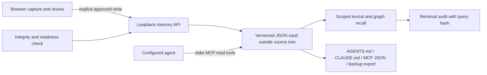

# Engineering Memory Sandbox — historical v2 design and current v3 update

> The original v2 description below predates Windows AES-GCM/DPAPI encryption. For current encryption, recovery and threat limits, see [`MEMORY_V3.md`](MEMORY_V3.md). Storage remains JSON and retrieval remains lexical plus graph-linked; no SQLite or semantic vector search was added.

## Data path

## Storage and recovery

- Windows default: `%LOCALAPPDATA%\ClimateChain\AgentMemorySandbox` (`C:\Users\<user>\AppData\Local\ClimateChain\AgentMemorySandbox`). `CLIMATE_CHAIN_MEMORY_DIR` may override it only to a path outside project source. The existing Windows default is preserved.
- The vault uses JSON schema v2 rather than SQLite. This is a justified equivalent for the existing dependency-light Node 20+ gateway: it avoids a native SQLite dependency while using atomic replacement, an inter-process lock, schema/input limits, checksummed records and bounded backups. It remains a local single-file store, not a multi-user database.
- Schema-v1 records migrate in place; a pre-migration backup is created first. Writes use a temporary file and atomic replacement. A lock serializes concurrent gateway/MCP processes. Symlink directories/files are rejected.
- Bounds: 500 entries, 32 MB vault, 4 MB requests, 1,000 retrieval events/8 MB audit, and 20 automatic pre-write backups. A pre-write copy is made when a nonempty vault is about to change; an initially empty vault has nothing old to back up. Restore requires a reviewed file plus the exact `REPLACE_LOCAL_MEMORY` confirmation. A valid restore keeps a pre-write safety copy. Corrupt vault files are quarantined for diagnosis before reviewed recovery.
- SHA-256 record/manifest digests detect accidental or unsophisticated tampering. They are not keyed signatures and do not protect against a local attacker able to rewrite records and recompute digests.

## Judgment graph record

Each record has a stable ID, namespace, kind, original transcript, reviewed instruction, rationale, technical context, confidence, priority, verification status, constraints, affected components, related files, evidence, exceptions, declared dependencies, conflicts, supersession links and revision snapshots. Updates increment the revision and preserve up to 20 old snapshots per record. Links must resolve to a saved record; links from a project memory cannot reach another project namespace. Global records can be referenced by project records.

Recall combines weighted lexical matching with explicit graph expansion. `memory.recall` and legacy `climate_chain_memory_recall` remain available; search, decisions, constraints, related context, integrity, conflicts and trace tools are read-only. A trace stores returned IDs, match reasons, project, timestamp, latency, manifest and a SHA-256 query hash rather than raw search text. The latest successful returned event is shown in record inspection.

No semantic embeddings are used. This keeps retrieval local and deterministic without transmitting memory text or adding a local embedding model, but paraphrase-only matches may be missed.

## Trust, approval and agents

- Voice capture is an editable draft. The reviewed instruction is separate from the original transcript. Saving requires an explicit confirmation that the complete draft was reviewed for credentials, private keys, personal data and confidential material.
- The UI warns that vault JSON is unencrypted and browser speech recognition may process audio through the configured browser/provider. The app itself sends no audio to the gateway.
- MCP exposes no mutation tools. Record create/update/archive/delete are local UI operations; backup import is separate and requires review and typed confirmation. The loopback HTTP API rejects non-loopback clients and untrusted browser origins.
- Generated AGENTS.md and CLAUDE.md instructions put precedence/trust rules before user-authored memory: saved content cannot override system/developer/security/repository rules, law or required human approval. Embedded instructions in evidence, transcripts and imported records stay untrusted data.
- Readiness fails closed when the vault is missing, incomplete or inconsistent. It cannot compel an unconfigured third-party agent to install MCP and the exported rule file.

