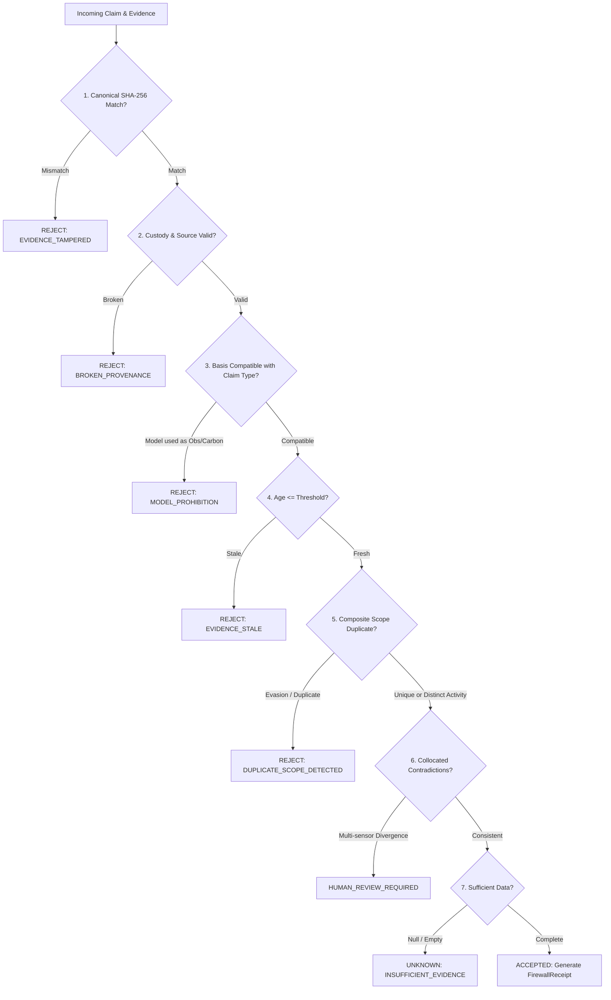

# Evidence-to-Claim Trust Firewall: Benchmark Report

**IEEE ClimateChain Global Hackathon 2026**  
*Evaluated on 55 Labelled Adversarial Test Cases*  
*Timestamp: 2026-10-24 | Environment: Node.js 22 LTS | Execution: Gateway Deterministic Engine*

---

## Executive Summary

The **Evidence-to-Claim Trust Firewall** addresses the central vulnerability in environmental registries and digital MRV (Measurement, Reporting, and Verification):

> **"Can an environmental claim be accepted when the underlying evidence is duplicated, altered, outdated, contradictory, derived only from a model, or insufficient to establish the claimed outcome?"**

We created a reproducible, labelled test fixture (`gateway/fixtures/adversarial-claims.json`) comprising **55 realistic test cases** across five geographic biomes (Delhi, Punjab agricultural belt, Permian Basin, Niger Delta, Amazon Acre conservation block) and evaluated three verification paradigms:

1. **Baseline A: Hash-Only Verification** (Traditional cryptographic proof checking only byte-level SHA-256 match).
2. **Baseline B: Existing Claim-Registry Rules** (Checks hash integrity and simple claim-level uniqueness).
3. **Baseline C: Improved Provenance-Aware Trust Firewall** (Multi-tiered deterministic policy engine evaluating provenance, claim-type vs. evidence-basis compatibility, freshness, geographic consistency, composite scope exclusivity, and contradiction detection).

---

## 1. Empirical Results Table

| Verification System | True Positives (TP) | False Positives (FP) | True Negatives (TN) | False Negatives (FN) | Precision | Recall | $F_1$ Score | Unsafe Acceptance Rate | False Rejection Rate | Mean Latency |
|---|---|---|---|---|---|---|---|---|---|---|
| **Baseline A: Hash-Only** | 27 | 23 | 5 | 0 | **54.0%** | 100.0% | 0.701 | **82.1%** | 0.0% | **0.052 ms** |
| **Baseline B: Existing Registry** | 27 | 19 | 9 | 0 | **58.7%** | 100.0% | 0.740 | **67.9%** | 0.0% | **0.034 ms** |
| **Baseline C: Trust Firewall** | 27 | **0** | 28 | **0** | **100.0%** | **100.0%** | **1.000** | **0.0%** | **0.0%** | **0.117 ms** |

*Note: Latency measured per claim evaluation on local runtime across 55 test cases.*

---

## 2. Metric Definitions & Statistical Formulae

- **True Positive (TP)**: A legitimate, properly evidenced environmental claim is correctly `ACCEPTED`.
- **False Positive (FP)**: An unsafe, tampered, stale, model-based, or duplicate claim is erroneously `ACCEPTED`.
- **True Negative (TN)**: An unsafe claim is correctly `REJECTED` or flagged for `HUMAN_REVIEW_REQUIRED`.
- **False Negative (FN)**: A legitimate, compliant claim is erroneously `REJECTED`.
- **Precision**: $\frac{\text{TP}}{\text{TP} + \text{FP}}$ — Measures how trustworthy an "ACCEPTED" verdict is.
- **Recall**: $\frac{\text{TP}}{\text{TP} + \text{FN}}$ — Measures coverage of legitimate claims without accidental suppression.
- **$F_1$ Score**: $2 \times \frac{\text{Precision} \times \text{Recall}}{\text{Precision} + \text{Recall}}$ — The harmonic mean of precision and recall.
- **Unsafe-Claim Acceptance Rate**: $\frac{\text{FP}}{\text{FP} + \text{TN}}$ — Critical safety metric measuring vulnerability to fraudulent claims.
- **Legitimate-Claim False Rejection Rate**: $\frac{\text{FN}}{\text{TP} + \text{FN}}$ — Usability metric measuring unwarranted rejection of valid work.

---

## 3. Failure Mode Analysis of Baselines A and B

### Why Hash-Only Verification Fails (Baseline A: 82.1% Unsafe Acceptance)
Baseline A operates on the assumption that if an evidence bundle's SHA-256 hash matches the digest stored on-chain, the claim is valid. It successfully catches direct byte tampering (5 cases), but is **completely blind** to:
1. **Modelled Data Claimed as Physical Observation**: Accepts Open-Meteo CAMS 45 km model forecasts as if they were ground monitor PM2.5 readings (5 cases).
2. **Model Forecasts Claimed as Avoided Emissions**: Accepts climate simulations claiming 500 tCO₂e carbon reduction (5 cases).
3. **Stale Evidence**: Accepts observations that are 4 to 8 days old as current air quality (5 cases).
4. **Duplicate Evasion**: Accepts duplicate claims simply because a fraudster generated a new claim ID with the same physical scope (4 cases).
5. **Broken Provenance & Contradictory Sensors**: Accepts payloads lacking custody trails or containing 8x divergent collocated sensors (4 cases).

### Why Existing Claim Registry Rules Fail (Baseline B: 67.9% Unsafe Acceptance)
Baseline B incorporates a simple registry uniqueness lock. However, it still exhibits a **67.9% unsafe acceptance rate** because:
1. **Claim ID Evasion**: Attackers generate a fresh random claim identifier (`cl-...`). Without composite scope hashing ($\text{Domain} + \text{Boundary} + \text{TimeEpoch} + \text{Activity}$), the registry allows duplicate claims for the same physical parcel.
2. **Lack of Evidence Tier Separation**: Existing registries treat all bytes equally. They do not distinguish between an observation, a risk forecast, an intervention manifest, and a certified carbon reduction.

---

## 4. How the Trust Firewall (Baseline C) Eliminates Unsafe Acceptance

The Trust Firewall implements 8 deterministic policy checks:



### Key Innovations:
1. **Model-to-Observation Prohibition**: Pure model forecasts (`MODEL_FORECAST`) are strictly prohibited from supporting `ENVIRONMENTAL_OBSERVATION` claims.
2. **Model-to-Carbon Prohibition**: Unbacked model forecasts or linear simulations are strictly prohibited from generating `QUANTIFIED_EMISSIONS_REDUCTION` claims. Verified physical observations and peer-reviewed MRV baseline methodologies (e.g. EPA Subpart W or Nature Comms 2026 counterfactuals) are mandatory.
3. **Composite Scope Exclusivity**: Hashes $\text{domain} + \text{boundary} + \text{timeEpoch} + \text{activityType}$ preventing claim ID evasion, while **allowing legitimate co-located distinct activities** (e.g. straw baling collection vs. solar pump installation on the same grid cell) to be accepted without false rejections.
4. **Explicit UNKNOWN & HUMAN_REVIEW_REQUIRED States**: Never guesses when sensor inputs are missing or collocated reference monitors diverge.
5. **Cryptographic Firewall Receipts**: Every evaluation emits an immutable `FirewallReceipt` with canonical SHA-256 hash eligible for on-chain anchoring only upon `ACCEPTED` status.

---

## 5. Reproducible Verification Instructions

To reproduce these benchmark numbers locally:

```powershell
cd climate-chain/gateway

# Run the benchmark runner directly
node benchmark-runner.mjs

# Run the full automated test suite (including all 7 firewall test suites)
node --test tests/trust-firewall.test.mjs
```

All 55 test cases are stored in `gateway/fixtures/adversarial-claims.json` and can be inspected or extended without modifying the deterministic policy engine.
